<div align="center">

**English** · [Türkçe](README.tr.md)


# deskhub-mobile

**Turn an old Android phone into a desk dashboard for your Windows PC.**

No extra hardware, no app to install: the phone only needs its browser.

[](https://github.com/Metecode/deskhub-mobile/actions/workflows/ci.yml)
[](LICENSE)


[Pages](#pages) · [Quick start](#quick-start) · [How it works](#how-it-works) · [Security](#security) · [Documentation](#documentation)

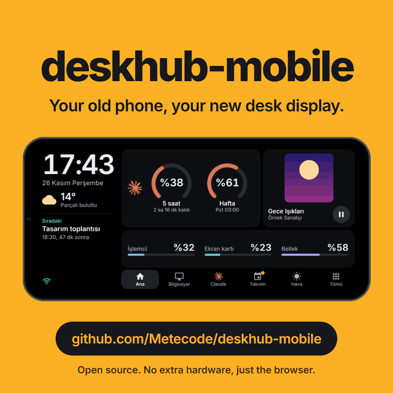

</div>

[Desk Hub](https://github.com/zacharyinserra/deskhub) shows your PC's data on an ESP32 display board.
deskhub-mobile puts an old phone in that board's place. The Desk Hub companion on the PC runs **unmodified**; a
small bridge next to it behaves like the board, and the phone shows the result in a layout of its own.

> [!NOTE]
> This is an unofficial community client, not affiliated with or endorsed by the Desk Hub project. Please don't
> report problems with it there. **The app, its launcher and the QR page are in Turkish**; all texts of the app are
> in one file, [apps/web/src/text.ts](apps/web/src/text.ts).

## Why

- **Glanceable.** Time, weather and the next event stay in a panel beside every page.
- **Two-way.** Control the music, start a game, mute the microphone or run a shortcut with a tap.
- **Made to stay on.** Pure black for OLED, pixel shifting and dimming against burn-in, a night mode, and the screen
  is kept awake.
- **Works without the PC too.** The clock, the weather, the timer and the last calendar go on while it is off.
- **One double-click.** The launcher makes the tokens, installs, builds, starts and shows a QR code to scan.
- **Local.** No account and no cloud of its own: the phone talks to your PC, and to Open-Meteo for the weather.

## Pages

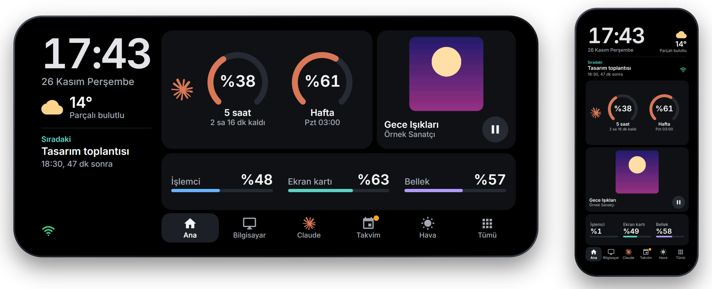

<table>
  <tr>
    <td width="50%">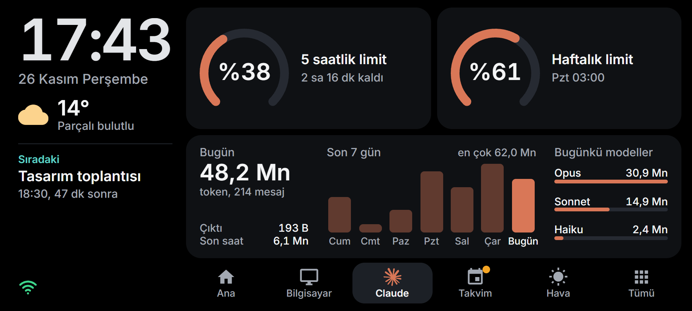<br><b>AI usage</b>: Claude or Codex limits, tokens and models</td>
    <td width="50%">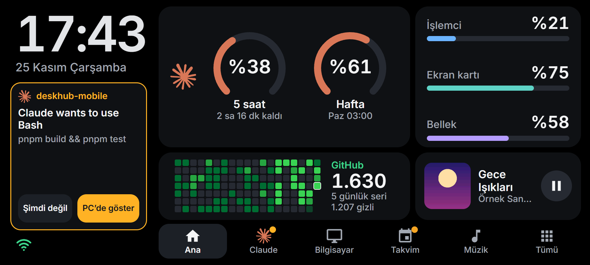<br><b>Alerts</b>: Claude Code needs you, on every page</td>
  </tr>
  <tr>
    <td>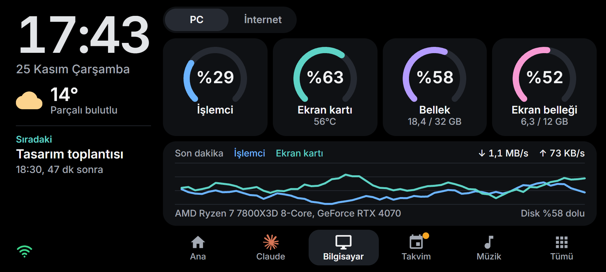<br><b>PC</b>: processor, graphics card, memory, network and disk</td>
    <td>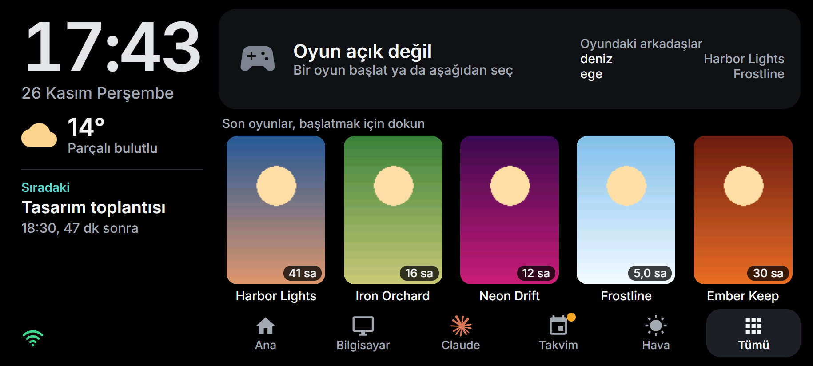<br><b>Games</b>: recent games, friends, start with a tap</td>
  </tr>
  <tr>
    <td>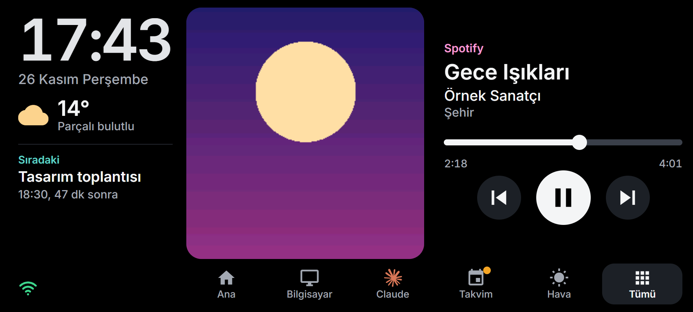<br><b>Media</b>: what is playing, with controls</td>
    <td>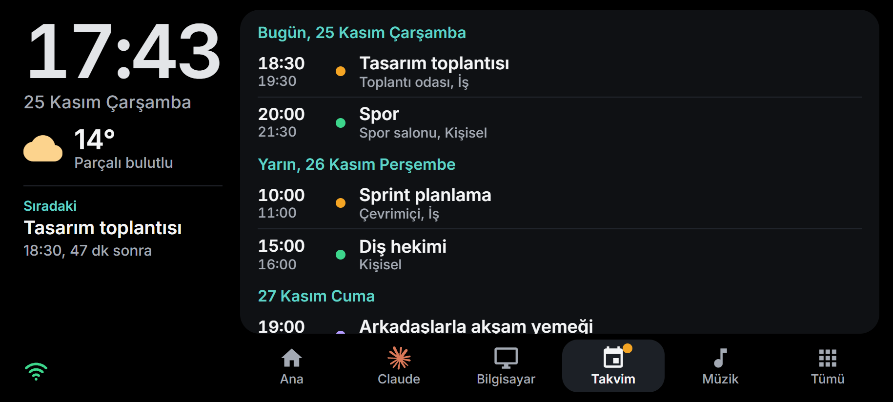<br><b>Calendar</b>: Google, iCloud, Outlook or any ICS link</td>
  </tr>
</table>

<details>
<summary><b>More pages</b>: weather, GitHub, 3D printers, shortcuts, timer</summary>
<br>
<table>
  <tr>
    <td width="50%">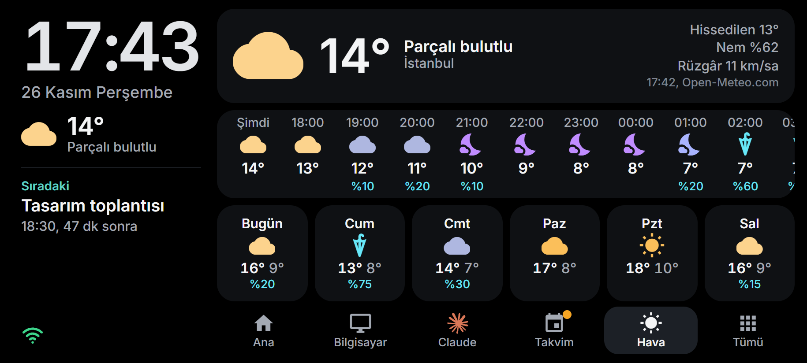<br><b>Weather</b>: now, by the hour and for six days</td>
    <td width="50%">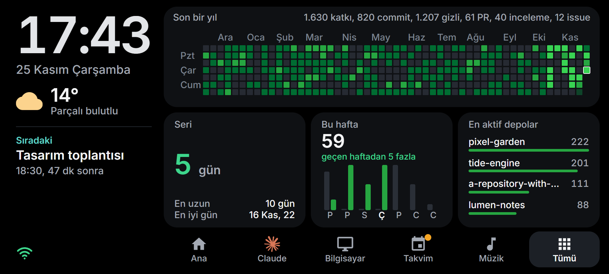<br><b>GitHub</b>: contributions, streak and repositories</td>
  </tr>
  <tr>
    <td>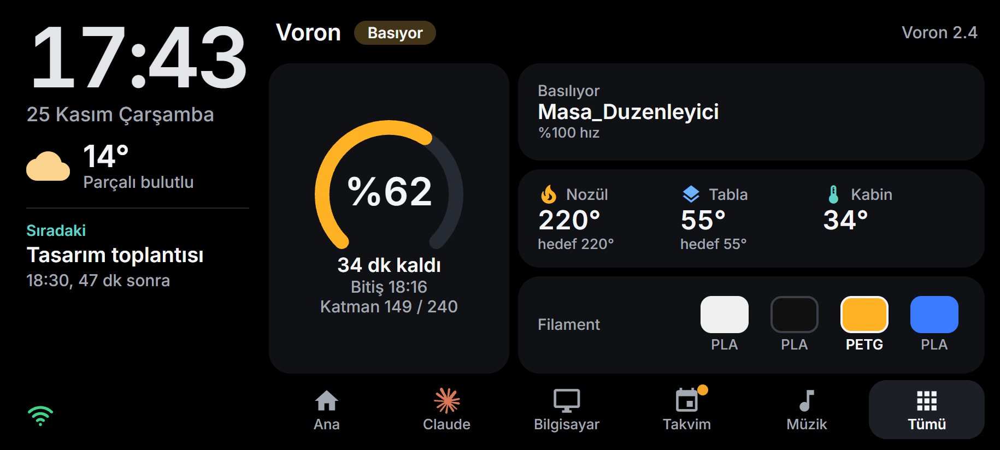<br><b>3D printers</b>: progress, temperatures and filament</td>
    <td>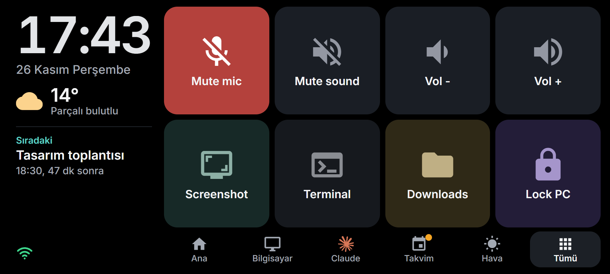<br><b>Shortcuts</b>: your own buttons, for keys, programs and links</td>
  </tr>
  <tr>
    <td>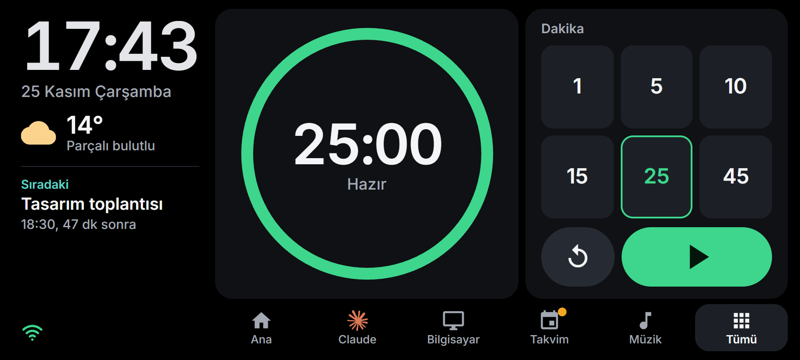<br><b>Timer</b>: with a beep and a vibration at the end</td>
    <td>And <b>Internet</b>: latency, drops, data usage and a speed test, next to the PC's load.</td>
  </tr>
</table>
</details>

<sub>The pictures show the real app with made-up data.</sub>

## Quick start

**You need** a Windows PC and an Android phone with a current Chrome, on the same network.

**1. Install the programs** (skip those you have)

```powershell
winget install -e --id Git.Git
winget install -e --id OpenJS.NodeJS.LTS   # 22.12 or newer
winget install -e --id astral-sh.uv
```

Close the terminal, open a new one, and:

```powershell
npm.cmd install -g pnpm@10
```

**2. Get both projects, side by side, and install the companion**

```powershell
git clone https://github.com/zacharyinserra/deskhub
git clone https://github.com/Metecode/deskhub-mobile
cd deskhub
git checkout b78c505   # the version this was written for
cd companion
uv sync
copy config.example.toml config.toml
```

**3. Double-click `deskhub-mobile.cmd`**, in the `deskhub-mobile` folder

Press Enter for the companion's folder. It makes `.env` and offers to open it together with the companion's
`config.toml`. Change these two lines there, with the `HUB_TOKEN` from `.env`, and save:

```toml
[hub]
host = "127.0.0.1:8765"
token = "the HUB_TOKEN from .env"
```

For the weather, fill in `WEATHER_LATITUDE` and `WEATHER_LONGITUDE` in `.env` as well. Then it installs, builds,
starts everything and shows a QR code. Say yes to the firewall rule; your network must be *Private* in Windows'
network settings.

**4. Scan the QR code with the phone**

**5. Let the phone keep its screen on**

On the phone, open `chrome://flags/#unsafely-treat-insecure-origin-as-secure`, enter the PC's address (such as
`http://192.168.1.20:8765`), choose *Enabled* and tap *Relaunch*.

### Make it yours

Run these in `deskhub\companion`, then restart with **Y** in the launcher's window:

| For | Command |
| --- | --- |
| Calendars | `uv run deskhub-setup calendar` |
| Claude limits and alerts | `uv run deskhub-setup claude` |
| Shortcut buttons | `uv run deskhub-setup shortcuts` |
| Steam and other games | `uv run deskhub-setup games` |
| GitHub chart | `uv run deskhub-setup github` |
| Pages, Home's layout | `uv run deskhub-setup pages`, `uv run deskhub-setup home` |

> [!IMPORTANT]
> Always name a topic. `deskhub-setup` on its own also goes through the ESP32 board and its firmware, which you
> don't need here. The weather's place is in `.env`, not in its `weather` topic.

> [!TIP]
> The [setup guide](docs/setup.md) has every step by hand, the firewall, a fixed address, starting with Windows
> and the home screen.

## How it works

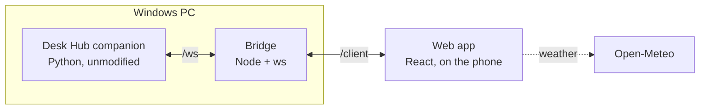

| Part | What it does |
| --- | --- |
| [packages/protocol](packages/protocol) | Zod schemas and types that the bridge and the web app share |
| [apps/bridge](apps/bridge) | Behaves like the board towards the companion, serves the phones and the web app |
| [apps/web](apps/web) | React, Vite and CSS modules; works offline through a service worker |
| [tools](tools) | The launcher, starting with Windows, a stand-in 3D printer |

## Security

- Phones need a token to see anything. Only the commands the board itself can send are passed on.
- Only a program on the PC itself can connect as the companion, and other websites can't connect through your browser.
- **Traffic isn't encrypted**: use it on a home network you trust, never on a public one or through a port forward.

[More on security](docs/security.md)

## Documentation

| | |
| --- | --- |
| [Setting up](docs/setup.md) | Every step, from the bridge to the phone |
| [What to know](docs/usage.md) | Tabs, sleep and night, burn-in, updates, and what's missing |
| [Security](docs/security.md) | What is protected, and what isn't |
| [Protocol](docs/protocol.md) | The messages between companion, bridge and phone |
| [CLAUDE.md](CLAUDE.md) | Project context, rules and phases |

## Development

```sh
pnpm install
pnpm dev        # bridge with made-up data, and Vite on port 5173
pnpm test
pnpm typecheck
```

`pnpm dev` doesn't need the companion, only a `CLIENT_TOKEN` in `.env`. The made-up PC goes offline for 10 seconds
now and then, on purpose. To open it on the phone, allow port 5173 in the firewall too.

[tools/fake-moonraker.mjs](tools/fake-moonraker.mjs) stands in for a 3D printer; how to point the companion at it
is at its top. [tools/launch.ps1](tools/launch.ps1) is what `deskhub-mobile.cmd` runs. How the project came about
is in the plans: [0](docs/plan-phase0.md), [1](docs/plan-phase1.md), [2](docs/plan-phase2.md),
[3](docs/plan-phase3.md), [4](docs/plan-phase4.md), [5](docs/plan-phase5.md).

## Credits and license

[MIT](LICENSE). Built on [Desk Hub](https://github.com/zacharyinserra/deskhub) (MIT), with weather data by
[Open-Meteo](https://open-meteo.com) (CC BY 4.0). Fonts, icons and trademarks: see [NOTICE](NOTICE).
