<div align="center">

[English](README.md) · **Türkçe**


# deskhub-mobile

**Eski Android telefonunu Windows PC'nin masa ekranına dönüştür.**

Ek donanım yok, kurulacak uygulama yok: telefonda sadece tarayıcı yeterli.

[](https://github.com/Metecode/deskhub-mobile/actions/workflows/ci.yml)
[](LICENSE)


[Sayfalar](#sayfalar) · [Hızlı kurulum](#hızlı-kurulum) · [Nasıl çalışır](#nasıl-çalışır) · [Güvenlik](#güvenlik) · [Belgeler](#belgeler)

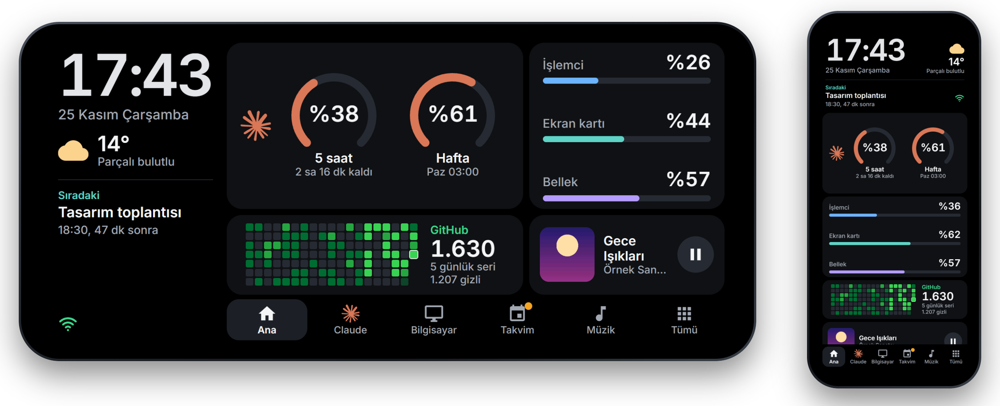

</div>

[Desk Hub](https://github.com/zacharyinserra/deskhub), PC'nin verilerini ESP32'li bir ekran kartında gösterir.
deskhub-mobile o kartın yerine eski bir telefonu koyar. PC'deki Desk Hub companion **hiç değiştirilmeden** çalışır.
Yanındaki küçük bir köprü (bridge) kart gibi davranır, telefon da sonucu kendi düzeniyle gösterir.

> [!NOTE]
> Bu, resmi olmayan bir topluluk istemcisidir. Desk Hub projesiyle bir bağı yoktur ve onun tarafından
> onaylanmamıştır. Sorunları lütfen oraya bildirme.

## Neden

- **Bir bakışta.** Saat, hava ve sıradaki etkinlik her sayfanın yanında durur.
- **İki yönlü.** Müziği yönet, oyun başlat, mikrofonu kapat ya da bir kısayolu tek dokunuşla çalıştır.
- **Açık kalmak için yapıldı.** OLED için tam siyah, ekran yanmasına karşı piksel kaydırma ve karartma, gece modu ve
  ekranı açık tutma.
- **PC kapalıyken de çalışır.** Saat, hava, zamanlayıcı ve son takvim devam eder.
- **Tek çift tık.** Başlatıcı anahtarları oluşturur, kurar, derler, başlatır ve okutman için QR kod gösterir.
- **Yerel.** Hesap yok, kendine ait bir bulut yok: telefon PC'nle, hava için de Open-Meteo ile konuşur.

## Sayfalar

<table>
  <tr>
    <td width="50%">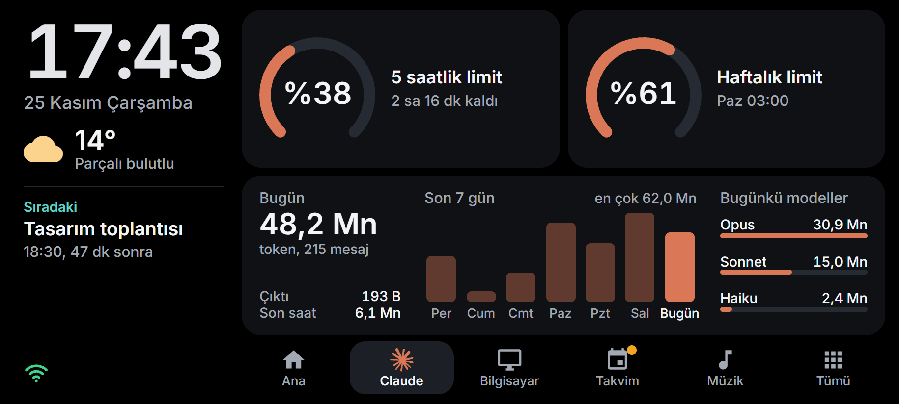<br><b>Yapay zekâ kullanımı</b>: Claude ya da Codex limitleri, token'lar ve modeller</td>
    <td width="50%">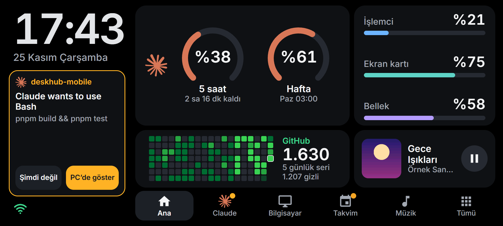<br><b>Uyarılar</b>: Claude Code seni bekliyorsa her sayfada görünür</td>
  </tr>
  <tr>
    <td>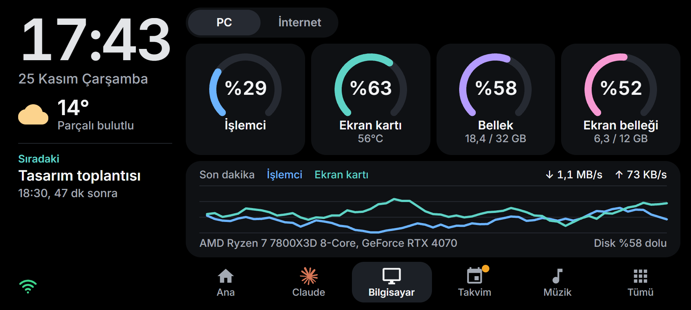<br><b>Bilgisayar</b>: işlemci, ekran kartı, bellek, ağ ve disk</td>
    <td>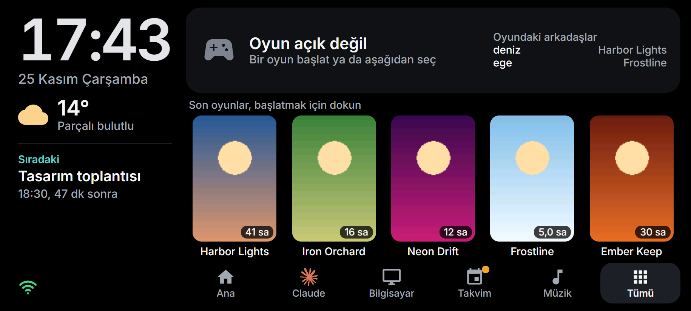<br><b>Oyunlar</b>: son oyunlar, arkadaşlar, dokunarak başlatma</td>
  </tr>
  <tr>
    <td>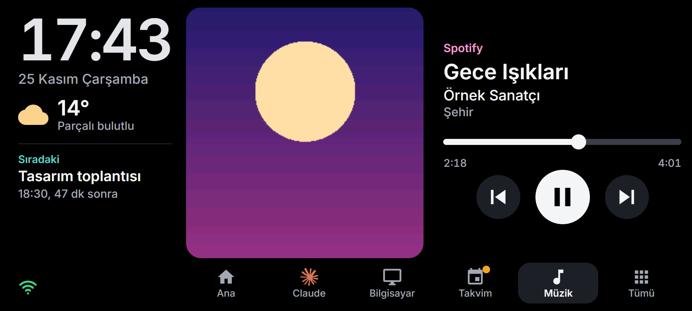<br><b>Müzik</b>: ne çaldığı ve kontroller</td>
    <td>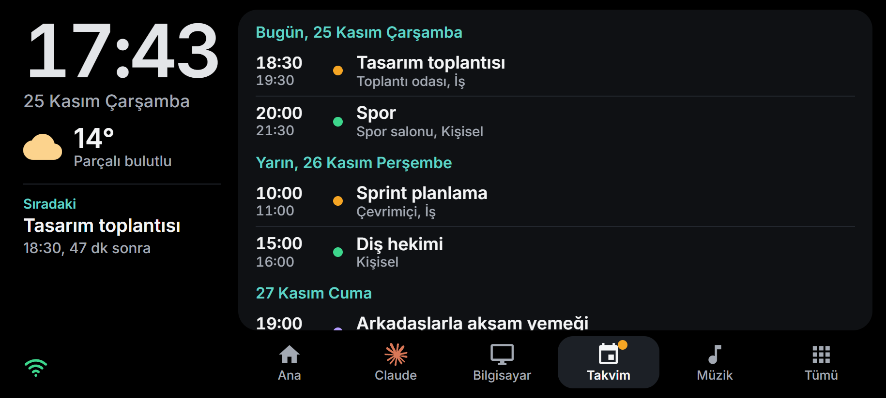<br><b>Takvim</b>: Google, iCloud, Outlook ya da herhangi bir ICS bağlantısı</td>
  </tr>
</table>

<details>
<summary><b>Diğer sayfalar</b>: hava, GitHub, 3B yazıcı, kısayollar, zamanlayıcı</summary>
<br>
<table>
  <tr>
    <td width="50%">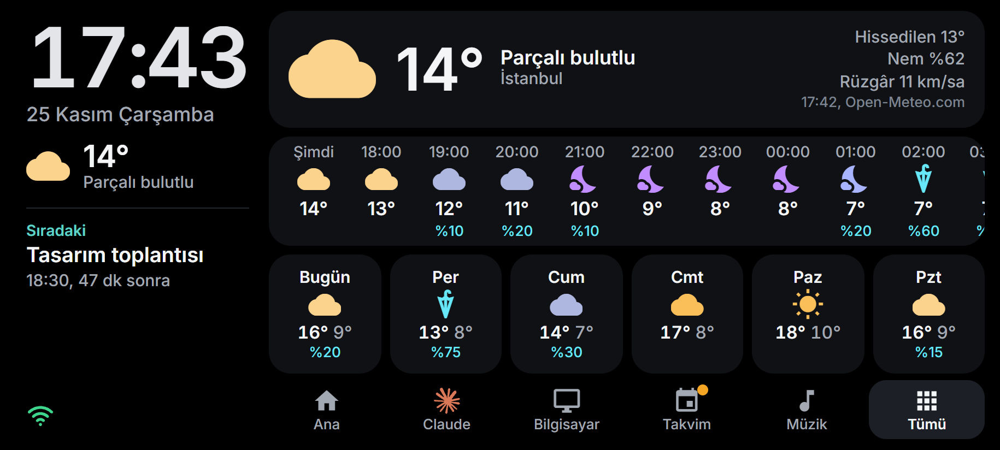<br><b>Hava</b>: şu an, saat saat ve altı günlük</td>
    <td width="50%">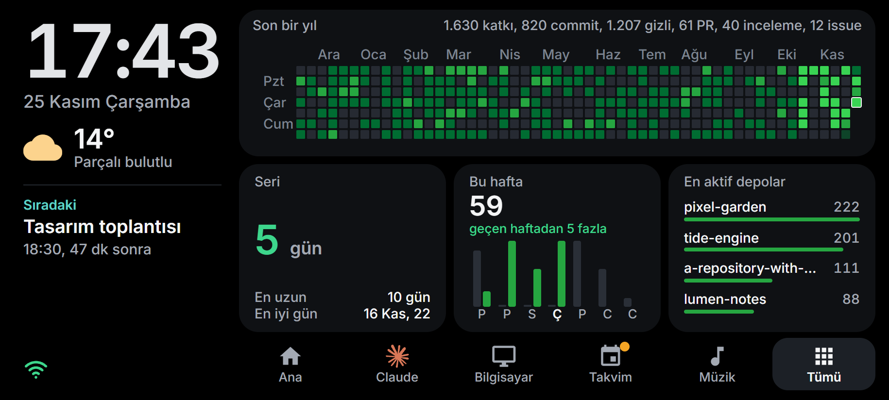<br><b>GitHub</b>: katkılar, seri ve depolar</td>
  </tr>
  <tr>
    <td>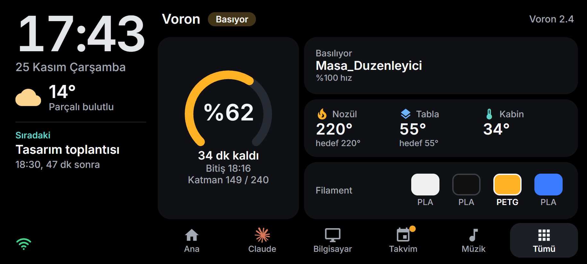<br><b>3B yazıcı</b>: ilerleme, sıcaklıklar ve filament</td>
    <td>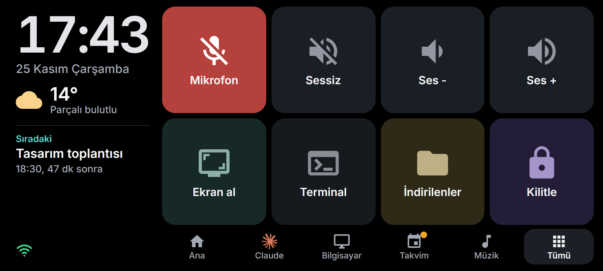<br><b>Kısayollar</b>: tuşlar, programlar ve bağlantılar için kendi düğmelerin</td>
  </tr>
  <tr>
    <td>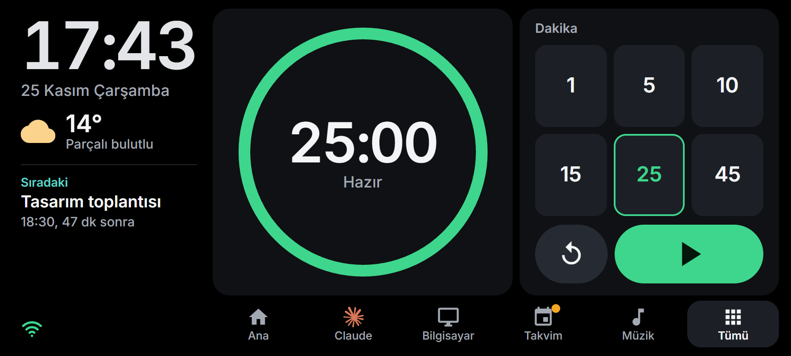<br><b>Zamanlayıcı</b>: bitince ses ve titreşim</td>
    <td>Ayrıca PC yükünün yanında <b>İnternet</b>: gecikme, kopmalar, veri kullanımı ve hız testi.</td>
  </tr>
</table>
</details>

<sub>Görüntüler uygulamanın gerçek hali, veriler uydurma.</sub>

## Hızlı kurulum

**Gerekenler:** [Node](https://nodejs.org) 22.12 ya da üstü, [pnpm](https://pnpm.io) 10 ve
[uv](https://docs.astral.sh/uv/) kurulu bir Windows PC; aynı ağda, güncel Chrome'lu bir telefon.

**1. İki projeyi yan yana indir ve companion'ı kur**

```powershell
git clone https://github.com/zacharyinserra/deskhub
git clone https://github.com/Metecode/deskhub-mobile
cd deskhub
git checkout b78c505   # bu projenin yazıldığı sürüm
cd companion
uv sync
copy config.example.toml config.toml
```

**2. `deskhub-mobile.cmd` dosyasına çift tıkla**

Her şeyi hazırlar ve companion'ın köprüye bağlanması için `config.toml`'da hangi iki satırı yazacağını söyler.

**3. QR kodu telefonla okut**

**4. Telefonun ekranı açık tutmasına izin ver**

Telefonda `chrome://flags/#unsafely-treat-insecure-origin-as-secure` sayfasını aç, PC'nin adresini yaz (örneğin
`http://192.168.1.20:8765`), *Enabled* seç ve *Relaunch*'a dokun.

> [!TIP]
> Elle kurulumun her adımı, güvenlik duvarı, sabit adres, Windows ile başlatma ve ana ekrana ekleme
> [kurulum kılavuzunda](docs/setup.md) (İngilizce).

## Nasıl çalışır

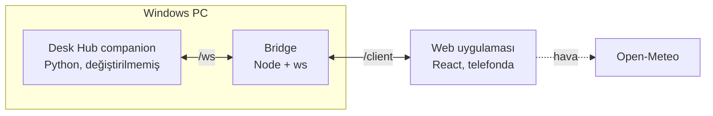

| Parça | Ne yapar |
| --- | --- |
| [packages/protocol](packages/protocol) | Köprü ile web uygulamasının paylaştığı Zod şemaları ve tipler |
| [apps/bridge](apps/bridge) | Companion'a karşı kart gibi davranır, telefonlara veriyi ve web uygulamasını sunar |
| [apps/web](apps/web) | React, Vite ve CSS modülleri; service worker ile çevrimdışı da açılır |
| [tools](tools) | Başlatıcı, Windows ile başlatma, denemek için sahte 3B yazıcı |

## Güvenlik

- Telefon, anahtar olmadan hiçbir şey göremez. Yalnızca kartın kendisinin gönderebildiği komutlar iletilir.
- Companion olarak sadece PC'nin kendisindeki bir program bağlanabilir, başka siteler de tarayıcın üzerinden bağlanamaz.
- **Trafik şifreli değildir**: güvendiğin bir ev ağında kullan; herkese açık ağda ya da port yönlendirmeyle kullanma.

[Güvenlik ayrıntıları](docs/security.md) (İngilizce)

## Belgeler

Ayrıntılı belgeler İngilizce.

| | |
| --- | --- |
| [Kurulum](docs/setup.md) | Köprüden telefona bütün adımlar |
| [Bilmen gerekenler](docs/usage.md) | Sekmeler, uyku ve gece, ekran yanması, güncellemeler, eksikler |
| [Güvenlik](docs/security.md) | Neyin korunduğu, neyin korunmadığı |
| [Protokol](docs/protocol.md) | Companion, köprü ve telefon arasındaki mesajlar |
| [CLAUDE.md](CLAUDE.md) | Proje bağlamı, kurallar ve aşamalar |

## Geliştirme

```sh
pnpm install
pnpm dev        # uydurma verili köprü ve 5173 portunda Vite
pnpm test
pnpm typecheck
```

`pnpm dev` için companion gerekmez, `.env` içinde bir `CLIENT_TOKEN` yeterli. Uydurma PC bilerek arada bir 10 saniye
çevrimdışı olur. Telefonda açmak için güvenlik duvarında 5173 portuna da izin ver.

## Teşekkür ve lisans

[MIT](LICENSE). [Desk Hub](https://github.com/zacharyinserra/deskhub) (MIT) üzerine kuruldu, hava verisi
[Open-Meteo](https://open-meteo.com) (CC BY 4.0). Yazı tipleri, simgeler ve markalar için [NOTICE](NOTICE).
